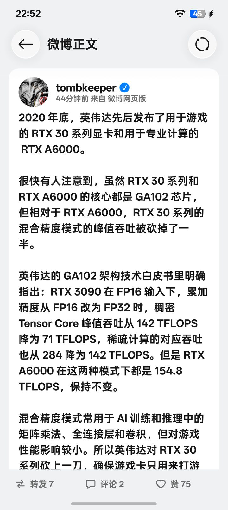

<div align="center">


# Cobo

**第三方微博客户端** · Kotlin + Jetpack Compose · UI 基于 COUI（ColorOS 17 设计语言）

[](https://github.com/Costben/COBO/releases/latest)


</div>

<div align="center">
  
  
  
  
</div>

<div align="center"><sub>信息流 · 详情页 · 长按玻璃菜单 · 图片查看器</sub></div>

---

## 特性

- **信息流**：推荐（`containerid=102803`）、关注（`feed/friends`）、好友圈（`feed/circle`），`since_id` / `max_id` 分页，下拉刷新
- **微博卡片**：正文富文本（@ / 话题 / 链接 / 表情）、九宫格图片、视频、转发块、来源与时间
- **详情页**：正文、评论（热度 / 时间双排序）、点赞、评论、转发
- **发布**：文字 + 多图上传、@ / 话题 / 表情工具条、草稿箱、编辑历史
- **图片**：查看器、原图加载、长按玻璃菜单保存（菜单从按下点展开、收回按下点）
- **主页与关系**：个人主页、用户微博、关注 / 粉丝
- **搜索**：热搜、关键词搜索、话题页
- **消息**：私信列表、通知
- **本地数据**：浏览历史、草稿、多账号、设置（深色模式 / 字号）
- **登录**：全屏官方网页登录，自动抓取并保存 Cookie

## 技术栈

| 层 | 选型 |
| :--- | :--- |
| 语言 / UI | Kotlin 2.4 · Jetpack Compose 1.11 |
| 设计系统 | [COUI](https://github.com/suqi8/coui)（ColorOS 17 组件库，本地快照） |
| 构建 | AGP 9.3.1 · Gradle 9.8.2 · JDK 21 |
| 网络 | OkHttp 4.12 |
| 图片 | Coil 3.6 |
| 视频 | Media3 ExoPlayer 1.11 |
| 数据层 | `m.weibo.cn` Web API（Cookie 复用） |

## 工程信息

| 项 | 值 |
| :--- | :--- |
| applicationId | `com.cobo.app` |
| 应用名 | Cobo |
| 版本 | 1.0.0（versionCode 10000） |
| minSdk / targetSdk | 26 / 37 |
| 工程 | `frontend/`（独立 Gradle 工程） |

## 目录

```
Cobo COUI/
├── frontend/                     # Android 应用（com.cobo.app）
│   ├── app/                      # 应用模块
│   │   └── src/main/kotlin/com/cobo/app/
│   │       ├── data/             # API、模型、缓存、设置
│   │       ├── screen/           # 页面
│   │       └── ui/               # 导航、主题、组件
│   ├── scripts/publish-coui.sh   # 发布本地 COUI 到本地 Maven 仓库
│   ├── scripts/e2e.sh            # 真机端到端测试
│   └── gradlew                   # Gradle 9.8.2
├── docs/                         # 设计文档与截图
└── README.md
```

## 构建

```bash
cd frontend
./scripts/publish-coui.sh          # 首次构建前：把 COUI 快照发布到本地 Maven 仓库
./gradlew :app:assembleRelease     # 产物：app/build/outputs/apk/release/app-release.apk
```

`settings.gradle.kts` 从同级目录 `../../coui/build/repository/local` 解析 COUI，构建前先确保该仓库已 `publishToMavenLocal`。

## 安装

```bash
adb install -r --no-incremental app/build/outputs/apk/release/app-release.apk
```

## 测试

```bash
cd frontend
./scripts/e2e.sh                   # 真机端到端测试（需已登录）
```

## 文档

| 文档 | 内容 |
| :--- | :--- |
| [`01-微博API.md`](docs/01-微博API.md) | Host、公共参数、接口目录、上传、返回结构与错误码 |
| [`02-技术方案.md`](docs/02-技术方案.md) | 技术栈、模块拆分、数据模型、里程碑、关键实现 |
| [`03-功能清单.md`](docs/03-功能清单.md) | 已实现功能与对应接口、已知边界 |
| [`04-前端架构.md`](docs/04-前端架构.md) | COUI 主题、导航、页面清单与实测记录 |
| [`05-端到端测试.md`](docs/05-端到端测试.md) | E2E 套件、覆盖范围与运行方式 |

## 说明

第三方客户端，与微博官方无关，仅个人使用。
