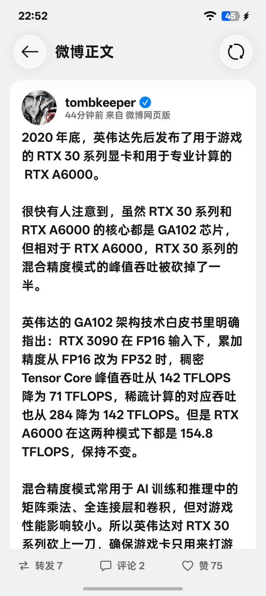
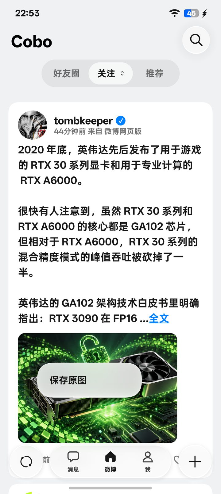

<div align="center">


# Cobo

**第三方微博多端客户端（Android & iOS）** · Kotlin Multiplatform + Compose Multiplatform · UI 基于 COUI 17（ColorOS 17 设计语言）

[](https://github.com/Costben/COBO/releases/latest)


</div>

<div align="center">
  
  
  
  
</div>

<div align="center"><sub>信息流 · 详情页 · 长按玻璃菜单 · 图片查看器</sub></div>

---

## 特性

- **信息流**：推荐、关注、好友圈、自定义分组与本地关注列表，支持续看快照、倒序浏览与下拉刷新
- **微博卡片**：正文富文本（@ / 话题 / 链接 / 表情）、九宫格与实况图、视频、转发块、来源与时间
- **详情页**：正文、评论（热度 / 时间双排序）、点赞、评论、转发、编辑历史
- **发布**：文字 + 多图 / 实况图上传、@ / 话题 / 表情工具条、草稿箱
- **媒体**：看图页（拖拽关闭联动、超长图分块解码、实况图播放与保存）、视频页（画中画、应用内小窗、手势播控、下载）
- **主页与关系**：个人主页、用户微博、关注 / 粉丝、超话
- **搜索与消息**：热搜、关键词搜索、话题页、私信列表、通知
- **本地数据与设置**：浏览历史、草稿、多账号、深色模式 / 强调色 / 字体缩放 / 顶栏与底栏自定义

## 技术栈

| 层 | Android | iOS |
| :--- | :--- | :--- |
| 语言 / UI | Kotlin 2.4.10 · Compose Multiplatform 1.12.2 | Kotlin 2.4.10 · Compose Multiplatform 1.12.2 |
| 设计系统 | [COUI 17](https://github.com/Costben/coui17) (`1.2.0-SNAPSHOT`) | [COUI 17](https://github.com/Costben/coui17) (`1.2.0-SNAPSHOT`) |
| 构建 | AGP 9.3.2 · Gradle 9.8.2 · JDK 21 | Xcode 16+ (iOS 17+) · Gradle 9.8.2 · JDK 21 |
| 网络 / 图片 | OkHttp 4.12 · Coil 3.6.3 | Ktor Client 3.5.1 (Darwin) · Coil 3.6.3 |
| 视频 / 实况 | Media3 ExoPlayer 1.11 · MotionPhoto 重封装 | `AVPlayer` + `AVPlayerLayer` · `PHPhotoLibrary` |
| 网页与存储 | `WebView` · `AndroidKeyStore` AES-GCM | `WKWebView` · iOS Keychain |

## 目录结构

```text
Cobo COUI/
├── shared/                       # KMP 共享模块（com.cobo.app.shared）
│   └── src/
│       ├── commonMain/           # 跨端共享的数据层、页面、组件、JSON 与平台抽象
│       ├── androidMain/          # Android 平台实现（OkHttp、Media3、MotionPhoto、WebView、长图分块、应用内更新）
│       ├── iosMain/              # iOS 平台实现（Ktor、WKWebView、AVPlayer、Keychain、Photos、CoreLocation）
│       └── androidHostTest/      # JVM 单元测试套件
├── app/                          # Android 应用宿主（com.cobo.app）与真机 E2E 测试
├── iosApp/                       # iOS Xcode 宿主工程（AppDelegate / SceneDelegate / 旋转与状态栏桥接）
├── scripts/                      # 构建与调试脚本（e2e.sh / publish-coui.sh / sign-install.sh）
├── docs/                         # 设计文档与截图
└── .github/workflows/build.yml   # Android + iOS 双端 CI
```

## 构建与运行

### 环境要求

- JDK 21、Gradle 9.8.2（仓库自带 `./gradlew`）
- Android：API 37 + Build Tools 37.0.0，在 `local.properties` 设置 `sdk.dir`
- iOS：macOS + Xcode 16+ (iOS 17.0+)
- COUI 17 依赖 `io.github.suqi8.coui.kmp:*:1.2.0-SNAPSHOT`，上级目录存在 `../coui/build/repository/local` 时优先读取本地产物，外部环境自动回退到 [Costben/coui17 `maven-repo`](https://github.com/Costben/coui17/tree/maven-repo) 分支

### Android

```bash
# 单元测试
./gradlew :shared:testAndroidHostTest

# 编译 Debug / Release APK（或使用 winbuild :app:assembleRelease）
./gradlew :app:assembleDebug
./gradlew :app:assembleRelease

# 覆盖安装
adb install -r --no-incremental app/build/outputs/apk/release/app-release.apk

# 真机端到端测试（需已登录）
./scripts/e2e.sh
```

### iOS

```bash
export JAVA_HOME=/opt/homebrew/opt/openjdk@21/libexec/openjdk.jdk/Contents/Home

# 编译模拟器框架
./gradlew :shared:linkDebugFrameworkIosSimulatorArm64

# 编译真机 Release App（无签名）
xcodebuild \
  -project iosApp/iosApp.xcodeproj \
  -scheme iosApp \
  -configuration Release \
  -sdk iphoneos \
  -arch arm64 \
  -derivedDataPath build/ios-derived \
  CODE_SIGNING_ALLOWED=NO \
  CODE_SIGNING_REQUIRED=NO \
  CODE_SIGN_IDENTITY="" \
  DEVELOPMENT_TEAM="" \
  PROVISIONING_PROFILE_SPECIFIER="" \
  build

# 本地签名并安装到已连接 iPhone
./scripts/sign-install.sh build/ios-derived/Build/Products/Release-iphoneos/Cobo.app --launch
```

## 文档

| 文档 | 内容 |
| :--- | :--- |
| [`01-微博API.md`](docs/01-微博API.md) | Host、公共参数、接口目录、上传、返回结构与错误码 |
| [`02-技术方案.md`](docs/02-技术方案.md) | 技术栈、模块拆分、数据模型、里程碑、关键实现 |
| [`03-功能清单.md`](docs/03-功能清单.md) | 已实现功能与对应接口、已知边界 |
| [`04-前端架构.md`](docs/04-前端架构.md) | COUI 主题、导航、页面清单与实测记录 |
| [`05-端到端测试.md`](docs/05-端到端测试.md) | E2E 套件、覆盖范围与运行方式 |

## 说明

第三方客户端，与微博官方无关，仅个人使用。
